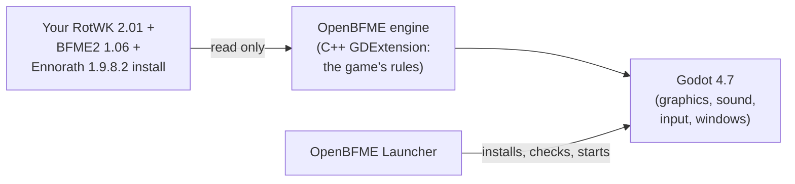

<div align="center">

# OpenBFME — Ennorath 1.9.8.2 Port

**The Battle for Middle-earth II: The Rise of the Witch-king 2.01 & the [Ennorath 1.9.8.2](https://ennorathmod.ru/) overhaul mod, rebuilt in Godot 4.7.**[cite: 2, 3]

[](https://github.com/Gleb302596555/openbfme-godot)
[](https://ennorathmod.ru/)
[](https://github.com/Gleb302596555/openbfme-godot/releases)
[](LICENSE)
[](https://godotengine.org)
[](#play-it)

<a href="https://github.com/Gleb302596555/openbfme-godot/releases"></a>

<sub>The newest Ennorath build is at the top of this fork's releases page: <code>OpenBFME-Ennorath-…-windows-x64.zip</code>. It holds no game or mod files: you need your own Rise of the Witch-king with Ennorath 1.9.8.2 (All In One BFME Launcher) and BFME2 1.06; unpack the zip and start <code>OpenBFME.exe</code>. The upstream vanilla builds are on <a href="https://github.com/Open-BFME/openbfme-godot/releases">Open-BFME's releases page</a>.</sub>

[About this fork](#about-this-fork) · [Ennorath port specification](#ennorath-port-specification) · [What it is](#what-it-is) · [Play it](#play-it) · [Status](#status) · [Where it's going](#where-its-going) · [Build from source](#build-from-source) · [Player guide](docs/PLAYING.md) · [Roadmap](docs/ROADMAP.md)

</div>

---

## About this fork

This repository is a dedicated fork of **[Gleb302596555/openbfme-godot](https://github.com/Gleb302596555/openbfme-godot)** (built on **[Open-BFME/openbfme-godot](https://github.com/Open-BFME/openbfme-godot)**)[cite: 2].

* **Main upstream repository ([Gleb302596555/openbfme-godot](https://github.com/Gleb302596555/openbfme-godot)):** Focuses on porting vanilla **The Battle for Middle-earth II: The Rise of the Witch-king 2.01** and starting support for several other mods[cite: 2].
* **This fork:** Specifically targets porting the **[Ennorath 1.9.8.2](https://ennorathmod.ru/)** overhaul mod[cite: 3].

**Goal:** **Ennorath 1.9.8.2** on the OpenBFME engine behaves the same way it does on **RotWK 2.01**[cite: 3]. The mod itself is not modified; instead, we fix and implement the general mechanisms of the engine[cite: 3].

---

## Ennorath port specification

### Baseline: Ennorath 1.9.8.2
* **Base version:** **Ennorath 1.9.8.2** as of 2026-11-04 (previously 1.9.8.1, owner decision on 2026-11-03)[cite: 3].
* **Mod archives and patch notes:** The patch was released on 2026-11-03; the updated `____enrth_data.big` and `_______enrth_textures3.big` archives are placed in `RotWK/`, and the patch note document `docs/ennorath/Ennorath mod Patch Note.docx` includes the 1.9.8.2 section[cite: 3].
* **Source of truth:** Test and verification expectations are taken from **1.9.8.2**[cite: 3]. The patch note is treated as the truth for how the mod should work: every item in it is verified, and any discrepancy between the port and the patch note is treated as a bug to investigate[cite: 3]. However, the final word belongs to the mod's actual files (INI files, scripts, and archive data of the current version) and the RotWK code: if a patch note item conflicts with the mod files, the files are considered correct and the discrepancy is recorded in the report[cite: 3]. Within the patch notes, the newest section (currently 1.9.8.2) governs, superseding older descriptions of the same mechanic[cite: 3]. Faction registries and tables captured before this date were made on 1.9.8; when they differ from current mod files, the current files take precedence[cite: 3].
* **Git policy:** Neither the mod files nor the patch note are stored in Git, and branches do not carry them; they are never copied or replaced across branches or worktrees[cite: 3].

### Order of work
Owner decision, 2026-11-02[cite: 3]:

1. **[Button Sweep (`docs/ennorath/BUTTON_SWEEP.md`)](docs/ennorath/BUTTON_SWEEP.md):** Checking what happens when every button of every faction is pressed[cite: 3].
2. **[Subsystems (`docs/ennorath/SUBSYSTEMS.md`)](docs/ennorath/SUBSYSTEMS.md):** Porting engine mechanisms grouped by root cause[cite: 3].
3. **[Faction Pass A–G (`docs/ENNORATH_FACTION_PLAN.md`)](docs/ENNORATH_FACTION_PLAN.md):** Walking through factions A–G from the plan as an acceptance pass rather than bug discovery[cite: 3].

Entries in [`docs/ennorath/PROBLEMS.md`](docs/ennorath/PROBLEMS.md) are symptoms: they are linked to subsystems and closed together with them[cite: 3]. Direct owner instructions take priority over this order[cite: 3].

### Ennorath documents

| Document | Contents | Maintained by |
|---|---|---|
| [Plan (`docs/ENNORATH_FACTION_PLAN.md`)](docs/ENNORATH_FACTION_PLAN.md) | stages, A–G cycle, status and workload rules[cite: 3] | manual[cite: 3] |
| [`docs/ennorath/PROCESS.md`](docs/ennorath/PROCESS.md) | how to work: branches, pipeline, tests, reporting[cite: 3] | manual[cite: 3] |
| [`docs/ennorath/BUTTON_SWEEP.md`](docs/ennorath/BUTTON_SWEEP.md) | specification for checking all buttons[cite: 3] | manual[cite: 3] |
| [`docs/ennorath/SUBSYSTEMS.md`](docs/ennorath/SUBSYSTEMS.md) | subsystems, their order, per-faction load, problem mapping[cite: 3] | manual[cite: 3] |
| `docs/ennorath/SWEEP.md` | button sweep results, generated at stage E2[cite: 3] | tooling[cite: 3] |
| [`docs/ennorath/PROBLEMS.md`](docs/ennorath/PROBLEMS.md) | owner complaints, "What is running" table[cite: 3] | owner and agents[cite: 3] |
| [`docs/ennorath/MODULE_GAPS.md`](docs/ennorath/MODULE_GAPS.md) | unported module classes[cite: 3] | `ennorath_queue.py`, `ennorath_unique.py`, manual[cite: 3] |
| [`docs/ennorath/CHECKLIST.md`](docs/ennorath/CHECKLIST.md) | batch for owner verification[cite: 3] | `ennorath_queue.py`[cite: 3] |
| [`docs/ennorath/TEST_BASELINE.md`](docs/ennorath/TEST_BASELINE.md) | failures acceptable before `land`[cite: 3] | from full test run[cite: 3] |
| [`docs/STOPS.md`](docs/STOPS.md) | what is unported or inferred[cite: 3] | agents; partially outdated, see SUBSYSTEMS, item 0[cite: 3] |
| `docs/ennorath/FactionXxx*.md` | faction registries[cite: 3] | `ennorath_docs.py` and manual[cite: 3] |

### Faction status

Inventory from 2026-11-02[cite: 3]. "Buttons" and "Powers" are graph estimates and are overstated; the matrix will provide the true denominator[cite: 3]. "Verified" counts registry rows with `VERIFIED` status[cite: 3]. The A–G cycle across factions is paused until stage E3 is complete[cite: 3].

| Faction | ID | Buttons | Powers | Objects | Registry | Matrix | Verified |
|---|---|---:|---:|---:|---|---|---:|
| Arnor | `FactionArnor` | 376 | 171 | 365 | [partial](docs/ennorath/FactionArnor.md) | none | 0[cite: 3] |
| Gondor | `FactionMen` | 404 | 180 | 329 | [partial](docs/ennorath/FactionMen.md) | none | 0[cite: 3] |
| Rohan | `FactionRohan` | 422 | 206 | 353 | none | [first slice](docs/ennorath/BUTTON_SWEEP.md): 98 buttons | 0[cite: 3] |
| Elves | `FactionElves` | 323 | 166 | 261 | none | none | 0[cite: 3] |
| Imladris | `FactionImladris` | 513 | 239 | 432 | none | none | 0[cite: 3] |
| Dwarves | `FactionDwarves` | 429 | 175 | 310 | none | none | 0[cite: 3] |
| Isengard | `FactionIsengard` | 338 | 159 | 281 | none | none | 0[cite: 3] |
| Mordor | `FactionMordor` | 413 | 189 | 338 | none | none | 0[cite: 3] |
| Goblins | `FactionWild` | 372 | 188 | 321 | none | none | 0[cite: 3] |
| Angmar | `FactionAngmar` | 381 | 184 | 354 | none | none | 0[cite: 3] |
| Harad | `FactionEvilmen` | 369 | 172 | 319 | none | none | 0[cite: 3] |

The state is updated alongside the work: whoever modifies a faction's registry or matrix updates the table[cite: 3]. The numbers can be reproduced with `workspace/ennorath-audit/tools/matrix.py`[cite: 3].

---

## What it is

OpenBFME is built with AI assistance and is still being optimized[cite: 2]. The Rise
of the Witch-king has not been decompiled yet, so many features are reverse
engineered from the game, and some use a stand-in until OpenBFME's RotWK
decompilation project is complete[cite: 2].

OpenBFME is a faithful, fan-made recreation of **The Rise of the Witch-king
2.01** (and in this fork, **Ennorath 1.9.8.2**) that runs on the original game files from your own install[cite: 2, 3]. This
repository contains no game assets: you bring your own copy of the game and mod, or
let the launcher download the base game (see [Play it](#play-it))[cite: 2, 3].

The game logic is C++ in a GDExtension (`engine/`)[cite: 2]. It is translated from
EA's Command & Conquer Generals: Zero Hour source and the BFME decompiles,
and checked against the RotWK program itself, keeping the original SAGE class
and file names[cite: 2]. Godot 4.7 (`godot/`) does the drawing, sound, input and
windows[cite: 2]. The previous codebase lives on in this repository's history (tag `legacy-final`)[cite: 2].



OpenBFME is unofficial[cite: 2]. It is not made or endorsed by EA[cite: 2].

---

## Play it

> **Alpha builds.** These are early alpha builds for testers[cite: 2]. Expect missing
> features and rough edges; see [Status](#status) and the known issues in the
> [player guide](docs/PLAYING.md#known-issues)[cite: 2]. Releases have plain numbers:
> Alpha 0.4.5, then 0.4.6 and so on, and the middle number goes up (0.5.0) when
> a big new feature lands[cite: 2]. Your launcher updates to each one by itself[cite: 2].

Having trouble? See the [troubleshooting guide](docs/TROUBLESHOOTING.md)
for game folders, updates, crashes, logs and online errors on Windows,
Linux and macOS[cite: 2].

**You need** **The Rise of the Witch-king 2.01**, **The Battle for
Middle-earth II 1.06** (in any language), and **[Ennorath 1.9.8.2](https://ennorathmod.ru/)** placed in your `RotWK/` folder, on x86-64 Windows 10/11 or x86-64
Linux with GLIBC 2.28 or newer and Vulkan graphics (or Direct3D 12 on Windows)[cite: 2, 3].

1. **Download OpenBFME** from
   [GitHub Releases](https://github.com/Open-BFME/openbfme-godot/releases) (or build this fork from source):
   `openbfme-<version>-windows-x64.zip` or
   `openbfme-<version>-linux-x64.tar.gz`[cite: 2]. It is one file with the game and the
   launcher in it[cite: 2]. Unpack it into a folder you can write to[cite: 2].
2. **Start the game or the launcher**: `OpenBFME.exe` or
   `OpenBFMELauncher.exe` (on Linux `./OpenBFME.x86_64` or
   `./OpenBFMELauncher.x86_64`)[cite: 2]. The game is ready to play, with no first
   download, and whichever one you start keeps OpenBFME up to date: a newer
   build is downloaded in the background, checked against the signed release,
   and used from your next start[cite: 2]. On Windows, SmartScreen may say
   *Windows protected your PC*, because the files are not code-signed yet:
   choose *More info*, then *Run anyway*[cite: 2].
3. **Play.** On the first start the game looks for your RotWK and BFME2
   folders (the registry entries the original installers write, and on Linux
   also Wine, Proton, Lutris, Heroic and Bottles prefixes)[cite: 2]. Confirm them or
   choose them with *Browse...*[cite: 2]. It checks every game file once (this can
   take a minute) and remembers the folders[cite: 2].

**No games installed?** The launcher shows *Download the games*: files from the
All In One BFME Launcher service (BFME Foundation, Patch 2.22 team), about
8.6 GB, every file checked[cite: 2].

**Logs.** Every run writes a session log, with your user name and home folder
removed[cite: 2]:

| | Log folder |
|---|---|
| Windows | `%APPDATA%\Godot\app_userdata\OpenBFME\logs\`[cite: 2] |
| Linux | `~/.local/share/godot/app_userdata/OpenBFME/logs/`[cite: 2] |

You never have to find it by hand: click **Logs** next to the version number
in the menus, or **Open log folder** in any error or crash message[cite: 2]. After a
crash, the next start tells you which log to send[cite: 2].

**Free camera.** The launcher's *Free camera* setting (Settings > General) lets
the camera zoom out to the whole map[cite: 2]. This is an OpenBFME option,
not part of the original game; in a game, Ctrl+Z switches it on and off[cite: 2]. From
the command line it is `-- --free-camera`[cite: 2].

Everything else (updates, hotkeys, troubleshooting) is in the
**[player guide](docs/PLAYING.md)**[cite: 2].

---

## Status

What works today, in plain terms[cite: 2]. "Partial" means you can use it but parts of
the original are still missing[cite: 2].

| Area | Status | Notes |
|---|---|---|
| Finding and checking your game files | ✅ Works | 2.01 / 1.06 installs in any language (the languages the All In One service lists are checked by MD5; others load with an in-game warning and a *Copy details* button so you can send them to us); the launcher's download picks the text and voice language[cite: 2] |
| Ennorath 1.9.8.2 overhaul mod | 🟡 In Progress | Dedicated target of this fork: button sweep, engine subsystem porting, and 11-faction verification against Ennorath 1.9.8.2[cite: 3] |
| Skirmish, all 7 vanilla factions | ✅ Works | Men, Elves, Dwarves, Isengard, Mordor, Goblins and Angmar; scripted test players played 71 games through the real menus and controls in the latest full sweep, every faction, with no crash or stall[cite: 2] |
| Combat, hordes, heroes, spell book | ✅ Works | horde formations, cavalry charges, sieges, powers; details are still being matched to the original[cite: 2] |
| Team colours | 🟡 Partial | units and buildings show their player's colour, but how the colour is blended in is an educated guess, not yet checked against the original[cite: 2] |
| Building, economy, upgrades | ✅ Works | builders, walls, castles, resources, upgrades and experience[cite: 2] |
| Computer opponent | 🟡 Partial | builds a base, trains armies and heroes, uses its spell book and most of its powers, attacks and finishes games; defending and expanding are not yet like the original[cite: 2] |
| In-game interface | ✅ Works | Palantir, command bar, RotWK's radar and pings, health bars and levels, control groups, camera bookmarks, hotkeys, right-click orders as in the original[cite: 2] |
| Main menu and options | 🟡 Partial | real menus with the original layout; the credits roll; the graphics detail level sets particles, texture quality and health bars, but shadows and the other detail rows are not drawn yet; OpenBFME's own settings inside Options[cite: 2] |
| Sound and music | 🟡 Partial | voices, effects, music and the original stereo image; some sounds (damage sounds, scripted music, parts of the big-battle ambience) are missing[cite: 2] |
| Movies | ✅ Works | the start-up logos and intro, and the campaign movies (no subtitles)[cite: 2] |
| Campaign | 🟡 Partial | missions start from the menu with their movies and narration; missions and campaign progress can be saved and loaded, including the between-mission menu and auto-save; saves are OpenBFME's own format and heroes do not carry over between missions yet[cite: 2] |
| LAN multiplayer | ✅ Works | Windows and Linux players in one game, disconnect screen, every game recorded[cite: 2] |
| Replays | 🟡 Partial | every game is recorded and can be watched from *Load Replay*; no saving under a name, no replay controls[cite: 2] |
| Create-a-Hero | ✅ Works | the hero builder, colours and saving; heroes can be fielded in skirmish and LAN[cite: 2] |
| Save / load | 🟡 Partial | skirmish and campaign missions save and load through the original Save / Load screens (OpenBFME's own save files, not the original game's)[cite: 2] |
| War of the Ring | ❌ Not yet |[cite: 2] |
| Online multiplayer | 🟡 Test feature | server browser, rejoin and spectating through an OpenBFME lobby and relay; the launcher's Multiplayer screen supports sign-in, friends and invitations; the lobby is configurable ([player guide](docs/PLAYING.md#online-play-test-feature))[cite: 2] |
| Mods | 🟡 Active (Ennorath 1.9.8.2) | designed in from the start; this fork is dedicated to porting Ennorath 1.9.8.2 (while upstream targets Edain first)[cite: 2, 3] |

**Faithful first.** OpenBFME copies the original game's behaviour; it does
not reinvent it[cite: 2]. Where the evidence runs out and the team has to make an
educated guess, that guess is not hidden: it is recorded as an *acceptance
stop* in [docs/STOPS.md](docs/STOPS.md), reported by the game at runtime and
pinned by a test. There are **928 open stops** today. Some are big
(retail save files), most are small details waiting for better evidence. The plan to
get to a 1:1 game is in [docs/ROADMAP.md](docs/ROADMAP.md).

**Latest version.** The newest build and its patch notes are on the
[releases page](https://github.com/Open-BFME/openbfme-godot/releases); the
history is in [docs/CHANGELOG.md](docs/CHANGELOG.md)[cite: 2].

---

## Where it's going

### In this fork
1. Complete the **Button Sweep** ([`docs/ennorath/BUTTON_SWEEP.md`](docs/ennorath/BUTTON_SWEEP.md)) across every button of all 11 Ennorath 1.9.8.2 factions[cite: 3].
2. Port all required **Subsystems** ([`docs/ennorath/SUBSYSTEMS.md`](docs/ennorath/SUBSYSTEMS.md)) and resolve symptoms tracked in [`docs/ennorath/PROBLEMS.md`](docs/ennorath/PROBLEMS.md)[cite: 3].
3. Execute the **A–G Faction Plan** ([`docs/ENNORATH_FACTION_PLAN.md`](docs/ENNORATH_FACTION_PLAN.md)) so Ennorath 1.9.8.2 behaves on OpenBFME just as it does on RotWK 2.01[cite: 3].

### Upstream roadmap
1. Skirmish and multiplayer parity with the original: every faction, the
   computer opponent, LAN and online games, replays[cite: 2].
2. The Rise of the Witch-king campaign[cite: 2].
3. The Battle for Middle-earth II Good and Evil campaigns[cite: 2].
4. War of the Ring[cite: 2].
5. Mods, with Edain first in upstream and Ennorath 1.9.8.2 in this fork[cite: 2, 3].

The full plan, with what is done and what is next, is in
[docs/ROADMAP.md](docs/ROADMAP.md)[cite: 2].

### Game editions

The engine is growing two editions, each with its own rules: **The Battle
for Middle-earth II 1.06** and **The Rise of the Witch-king 2.01**[cite: 2]. BFME2 is
the base: its rules come from the clean BFME2 1.06 program (`game.dat`), with
the Open-BFME-2 decompilation as the reading aid[cite: 2]. RotWK is BFME2 plus its
changes[cite: 2]. Today every game still runs RotWK's rules; the BFME2 edition is
being built behind a developer switch (see [docs/EDITIONS.md](docs/EDITIONS.md))[cite: 2].
Mods will declare which edition they are for[cite: 2]. BFME1 comes later[cite: 2].

---

## Build from source

You need Git with Git LFS, CMake (3.17 or newer), Ninja, Python 3, a C++17 compiler and
[Godot 4.7](https://godotengine.org/download)[cite: 2]. Clone with the `godot-cpp`
submodule (POSIX shell on Linux/macOS; run from your parent source folder)[cite: 2]:

```sh
git clone --recursive [https://github.com/Gleb302596555/openbfme-godot](https://github.com/Gleb302596555/openbfme-godot)
cd openbfme-godot
```

**Linux** (GCC or Clang, from the repository root)[cite: 2]. For MP3 fixture generation,
put the reference LAME 3.100 and mpg123 on `PATH`; otherwise use the reference
fixtures and `-DOPENBFME_LAME=OFF` as described below[cite: 2]:

```sh
cmake -S engine -B engine/build -G Ninja -DCMAKE_BUILD_TYPE=Release
cmake --build engine/build --target openbfme openbfme_tests   # extension -> godot/bin/
export ROTWK_INSTALL=/path/to/RotWK BFME2_INSTALL=/path/to/BFME2
engine/build/openbfme_tests                                   # unit tests (retail tests skip without the two folders)
godot --path godot                                            # start the game
```

**Windows only** (Visual Studio C++ x64/x86 tools, CMake, Ninja, Python on
`PATH`, reference MP3 tools or fixtures)[cite: 2]. Run from the repository root in an
x64 Native Tools Command Prompt; install the LLVM 19+ AST-audit prerequisites
in [docs/WINDOWS.md](docs/WINDOWS.md) first[cite: 2]:

```bat
build.bat
set "ROTWK_INSTALL=C:\Games\RotWK"
set "BFME2_INSTALL=C:\Games\BFME2"
set "GODOT=C:\path\to\Godot_v4.7.2-stable_win64_console.exe"
run_tests.bat
"%GODOT%" --path godot
```

`build.bat` writes the extension to `godot\bin` and the tests to
`engine\build`[cite: 2]. `run_tests.bat` runs the unit tests, simulation AST audit,
headless smoke test and windowed shader test[cite: 2]. With the default required AST
check, it exits 0 when all pass, 77 for a smoke/shader prerequisite skip,
and 1 for a failure[cite: 2]. Overriding `SIM_AUDIT_ARGS=--ast=skip` only warns and
continues, so a final 0 with that override is not proof of an AST pass[cite: 2]. Windows builds
can also be cross-compiled from Linux with `tools/release/build_windows.sh`;
see [docs/WINDOWS.md](docs/WINDOWS.md)[cite: 2]. Packaging and releases are described
in [docs/RELEASE.md](docs/RELEASE.md)[cite: 2].

MP3 decoder tests use the reference-machine fixtures (LAME 3.100, matching
`engine/tests/data/audio/mp3_golden.tsv`)[cite: 2]. Test-enabled configuration first checks
`<build>/audio_fixtures` (or `OPENBFME_AUDIO_FIXTURES`)[cite: 2]. Valid reference streams
need no encoder/decoder tools or extra flag, even if an incompatible LAME is on
PATH[cite: 2]. Otherwise generation requires LAME **3.100** and mpg123; other LAME versions
are rejected explicitly[cite: 2]. Missing fixtures/tools yield one configure warning,
never a configure/build error; exactly the five MP3 test cases fail at test time
with the reason and manual command[cite: 2]. For standalone generation outside a CMake sandbox,
run `python3 tools/audio/gen_mp3_fixtures.py --out workspace/audio_fixtures` from
the repository root[cite: 2]. See the [MP3 test README](engine/tests/data/audio/README.md)
for hash validation[cite: 2]. `-DOPENBFME_BUILD_TESTS=OFF` removes the C++ test target and
all MP3 fixture/tool checks for release-only builds[cite: 2]. `build.bat` and
`build.bat Release` build the extension, tests and test helpers without fixtures
or audio tools; executing the five MP3 cases still requires verified fixtures[cite: 2].

Instead of the environment variables, the install folders can live in
`user://install-paths.cfg` as `KEY=VALUE` lines (the game's first-run screen
writes this file)[cite: 2]. Mounting checks every archive's size and MD5 against
`engine/data/retail-archives/` and stops on any unknown or changed file[cite: 2]. The
load order is documented in `engine/src/Common/RetailArchivePolicy.h`[cite: 2].

---

## How it's made

The work is split into lanes, each porting one system from the RotWK 2.01
program, the Open-BFME decompiles and the Zero Hour source, citing the exact
address or file it comes from[cite: 2]. Every change is reviewed before it is merged,
and gates run the real retail data: the unit tests, scripted skirmish and LAN
games, replays that must match frame by frame, and Windows-vs-Linux lockstep
games that must stay in sync[cite: 2]. The standing rules are in
[docs/PLAN.md](docs/PLAN.md) and [docs/ennorath/PROCESS.md](docs/ennorath/PROCESS.md)[cite: 2, 3].

---

## Devlogs

Video devlogs on the [OpenBFME YouTube channel](https://www.youtube.com/@OpenBFMEGodot)[cite: 2]:

- [Devblog #1](https://www.youtube.com/watch?v=dPUWMVaxbSM)[cite: 2]
- [Devblog #2](https://www.youtube.com/watch?v=tynar_O2_ps)[cite: 2]
- [Devlog #3: You Asked, We Fixed](https://www.youtube.com/watch?v=15T9RJKba9g)[cite: 2]

---

## Feedback and bug reports

- **Bugs:** open an issue on
  [GitHub](https://github.com/Open-BFME/openbfme-godot/issues), or post in
  the OpenBFME Discord's `#bug-reports` forum (join from the YouTube channel
  page)[cite: 2]. For Ennorath-specific port issues, see [`docs/ennorath/PROBLEMS.md`](docs/ennorath/PROBLEMS.md)[cite: 3].
- **Always attach the session log** of the run where it happened (see
  [Logs](#play-it)), and say which version you played (it is shown in the top
  right corner of the menus) and what you did[cite: 2]. On Windows, send the log file,
  not a copy of the console window[cite: 2].
- Community reports and their state are tracked in the
  [roadmap](docs/ROADMAP.md#community-feedback-intake-fb-items-updated-2026-10-10)[cite: 2].
- **Pull requests** are welcome: [CONTRIBUTING.md](CONTRIBUTING.md) says how
  they are checked, reviewed and merged with the next release (and that game
  files never go into the repository)[cite: 2].

---

## Behaviour references

- **[Ennorath Mod 1.9.8.2](https://ennorathmod.ru/)**: INI files, scripts, `.big` archives (`____enrth_data.big`, `_______enrth_textures3.big`), and `docs/ennorath/Ennorath mod Patch Note.docx`[cite: 3].
- **Upstream Fork**: [Gleb302596555/openbfme-godot](https://github.com/Gleb302596555/openbfme-godot) & [Open-BFME/openbfme-godot](https://github.com/Open-BFME/openbfme-godot)[cite: 2].
- RotWK 2.01 INI files: every number in the game[cite: 2].
- EA's Command & Conquer Generals: Zero Hour source (GPL-3): the SAGE
  engine that BFME was built on[cite: 2].
- [Open-BFME-1](https://github.com/Open-BFME/Open-BFME-1) and
  [Open-BFME-2](https://github.com/Open-BFME/Open-BFME-2): matching
  decompilations of BFME1 and BFME2[cite: 2].

## Licence

GPL-3.0; see `LICENSE` and `NOTICE` (Zero Hour-derived parts and EA's terms)[cite: 2].